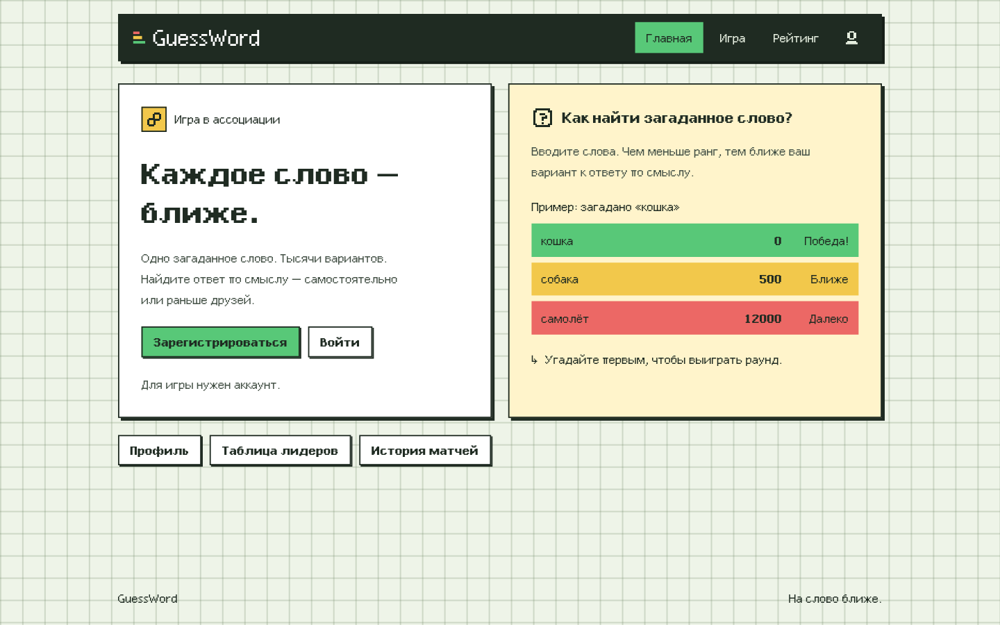
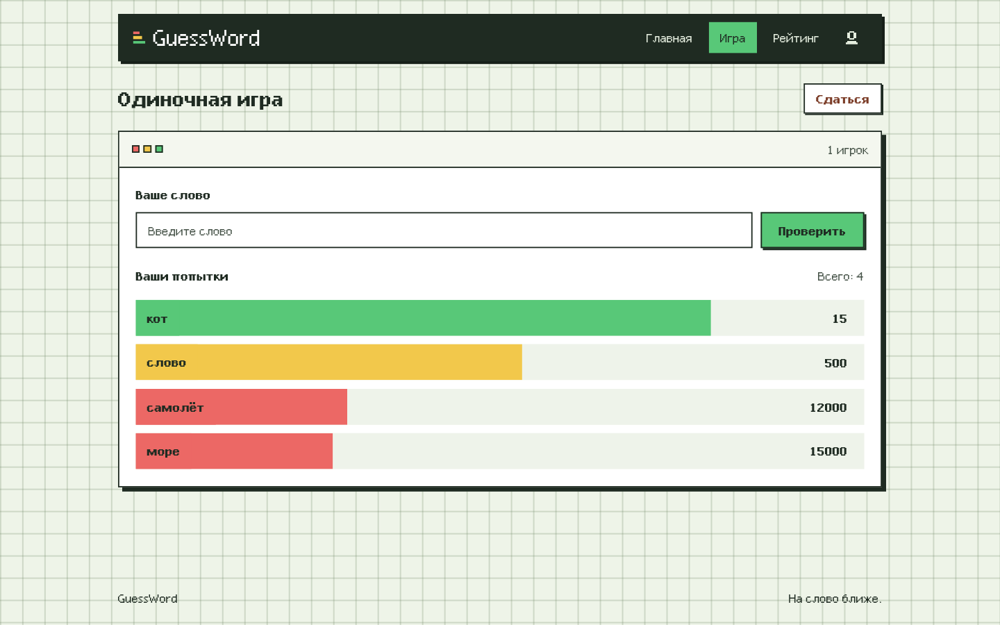
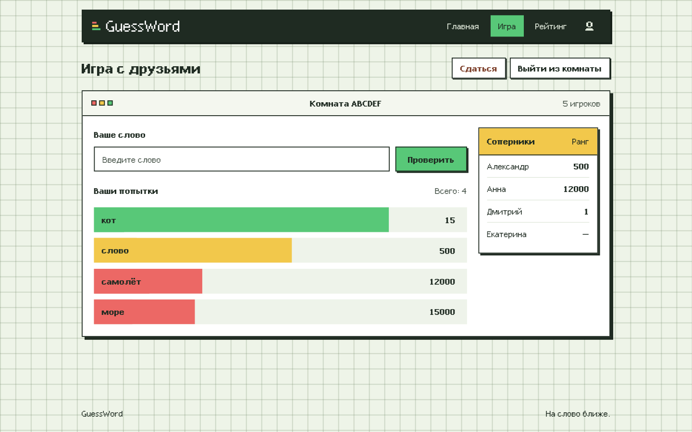

# GuessWord

Веб-игра на смысловую близость русских слов. Вводите варианты и ориентируйтесь на ранг:
чем он меньше, тем ближе слово к ответу. Цель — угадать загаданное слово.

Можно играть одному или соревноваться с друзьями в закрытой комнате на 2–5 человек.
Для игры нужен аккаунт; попытки и результаты сохраняются в PostgreSQL.

## Возможности

- Одиночная игра с сохранением попыток и восстановлением партии после обновления страницы.
- Комнаты по коду: хозяин запускает раунд при 2–5 участниках, все ищут один секрет.
- Обновления через SignalR: видны число попыток, лучший ранг и результат соперника;
  чужие слова скрыты.
- Возвращение в сетевой матч после обрыва связи и новые раунды в той же комнате.
- Сдача, выход из комнаты и передача прав хозяина оставшемуся участнику.
- История завершённых матчей, профиль со статистикой и таблица лидеров.
- Адаптивный интерфейс для компьютера и телефона.

## Локальный запуск

Нужны .NET SDK из [`global.json`](global.json) (10.0.403, `rollForward: latestFeature`),
PostgreSQL с pgvector и файл `sociation2vec800.vec` размерности 800.
Векторы и реальные настройки подключения в репозиторий не входят.

1. Подготовьте отдельную БД, векторы и настройки по [инструкции запуска](docs/operations/local-run.md#бд-словарь-и-настройки).
2. Из корня проекта соберите и запустите приложение:

```sh
dotnet restore GuessWord.slnx
dotnet build GuessWord.slnx -c Release --no-restore
dotnet run --project src/GuessWord.Api -c Release --no-build --launch-profile http
# В другом терминале:
dotnet run --project src/GuessWord.Client -c Release --no-build --launch-profile http
```

3. Откройте [клиент](http://localhost:5101), создайте аккаунт и выберите одиночную игру
   или создайте комнату и передайте её код друзьям.

API — `http://localhost:5280`; [Swagger](http://localhost:5280/swagger) включён в Development.
При запуске API применяет миграции и, если словарь пуст, импортирует векторы.
Эти шаги выполняются до начала приёма запросов.

Для контейнерного варианта подготовлены Compose и nginx. Конфигурации проверены;
контейнерная сборка и запуск ещё требуют отдельной проверки.

## Скриншоты

Главная страница:



Одиночная игра:



Матч на пять игроков:



[Все скриншоты, включая мобильные версии](artifacts/screenshots/).

## Технологии и структура

C# / .NET 10, ASP.NET Core Web API, Blazor WebAssembly, Entity Framework Core,
PostgreSQL с pgvector, SignalR и JWT. Для развёртывания подготовлены Docker Compose и nginx.

```text
src/GuessWord.Api/        # API, игровая логика, работа с БД и миграции
src/GuessWord.Client/     # Blazor-интерфейс
src/GuessWord.Contracts/  # Общие DTO и перечисления
deploy/                  # Docker, nginx и инициализация pgvector
tools/                   # Подготовка словаря и проверка публикации
docs/                    # Архитектура и запуск
artifacts/screenshots/   # Снимки интерфейса
```

## Документация

| Задача | Документ |
| --- | --- |
| Разобраться в компонентах, рангах и API | [Архитектура](docs/architecture/structure.md) |
| Настроить БД, запустить игру, проверить готовность | [Локальный запуск и Compose](docs/operations/local-run.md) |
| Подготовить сервер, резервную копию и откат | [Развёртывание](docs/operations/deployment.md) |
